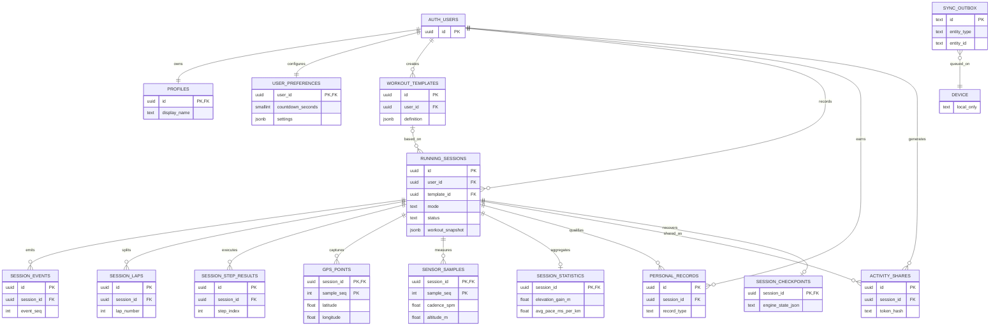

# PaceLab V6.4 — Database ER Diagram (Draft v001)

> Android + iOS share the same logical identifiers. SQLite is authoritative while a run is recorded; Supabase PostgreSQL holds synchronized data. This is a proposed design, not an applied migration.

## Important design decisions

- `running_sessions` is a durable session identity, created offline as a UUID. The recorded `workout_snapshot` must never silently change when a workout template is edited.
- Free Run: `session_laps` splits by kilometre with a separately marked partial last lap. Speedwork: `session_step_results` splits warmup/work/recovery/cooldown, including each repetition; only finished **work** sets trigger work-set announcements.
- `gps_points` saves quality, accepted/rejected status, elapsed time and cumulative distance; `sensor_samples` saves measured cadence, elevation, gradient, source, and confidence; use NULL for unavailable data.
- `session_statistics` is derived, recomputable and versioned. Personal best detection uses validated continuous segments; distance units internally use metres, time in milliseconds, timestamps in UTC.
- Only SQLite has `session_checkpoints` and `sync_outbox`; on-device transactions should write samples + checkpoints + outbox safely. Cloud sync should be idempotent and use monotonic revisions. Client conflict resolution and tombstone handling are implementation decisions to review.
- `activity_shares.public_payload` contains only explicitly whitelisted fields and never the raw GPS track. `token_hash` must be produced from a sufficiently random secret; an authenticated, rate-limited server endpoint is required to resolve public links. No direct anonymous SELECT policies on personal data.
- Supabase users are referenced through `auth.users`. Client-created profiles need a create-on-first-login flow or a separate reviewed trigger.
- Cloud raw GPS/sensor upload should be optional or downsampled for free-tier efficiency; local samples remain available for on-device analysis. A sync contract must specify what stays local and what goes to cloud.
- PostgreSQL supports scoped `ON DELETE SET NULL (template_id)` on the composite template FK. SQLite uses `NO ACTION` and **soft-delete** templates, preventing the composite FK from nulling `user_id`.

## Approval / validation checklist

1. Verify schemas in a development database, not production.
2. Perform user A / user B RLS isolation tests on all tables, including child tables and joins.
3. Exercise delete/soft-delete, sync retry, offline resume, duplicates, migrations and replays.
4. Verify time/distance unit conversion, kilometre partial laps, interval steps and GPS quality filtering.
5. Review cloud retention, token access controls, payload sanitization and generated exports.
